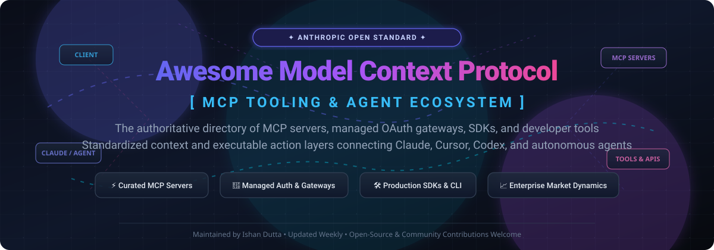

  

  
  
  
  
  
  

---

# ⚡ Awesome Model Context Protocol (MCP)

> **The definitive directory of Model Context Protocol (MCP) servers, managed SaaS gateways, developer SDKs, and enterprise agent infrastructure.**

The **Model Context Protocol (MCP)** is an open standard introduced by Anthropic that allows AI agents, LLMs, and assistants (Claude Desktop, Claude Code, Cursor, Codex, Windsurf, OpenCode) to securely connect to external tools, databases, enterprise SaaS platforms, and local developer environments via a standardized client-server protocol.

---

## 📑 Table of Contents

- [⚡ Awesome Model Context Protocol (MCP)](#-awesome-model-context-protocol-mcp)
  - [📑 Table of Contents](#-table-of-contents)
  - [📊 Sector Overview \& Market Dynamics](#-sector-overview--market-dynamics)
  - [🏢 Enterprise SaaS \& Managed MCP Gateways](#-enterprise-saas--managed-mcp-gateways)
  - [🛠️ Open-Source MCP Servers, SDKs \& Tooling](#️-open-source-mcp-servers-sdks--tooling)
  - [🎯 Key Architectural Highlights](#-key-architectural-highlights)
  - [🤝 How to Contribute](#-how-to-contribute)
  - [🛡️ Security \& Operational Disclaimer](#️-security--operational-disclaimer)
  - [📈 Star History](#-star-history)
  - [💖 Support \& Community](#-support--community)

---

## 📊 Sector Overview & Market Dynamics

The global AI agent infrastructure and autonomous execution market is projected to expand from **$7.84 billion in 2025 to over $52.62 billion by 2030** (compounding at a CAGR of 46.3%), catalyzed by widespread enterprise migration toward agentic tool execution and context-aware LLMs. 

The market exhibits a **bifurcated structure**:
- **Tooling & Integration Layer:** **Moderately to highly fragmented**, characterized by rapid product launches across managed OAuth gateways, specialized documentation search engines, local proxy runners, and open-source server repositories.
- **Foundational Execution Layer:** **Highly concentrated**, with hyperscalers and frontier model providers (Anthropic, OpenAI, Microsoft, Google) exerting strong gravity over protocol adoption, client interfaces, and foundational runtime primitives.

---

## 🏢 Enterprise SaaS & Managed MCP Gateways

The following commercial platforms offer managed authentication (OAuth 2.0 / API keys), hosted MCP proxy endpoints, token overhead optimization, and enterprise governance.

*Sorted descending by Company Size (Valuation / Total Capital Raised).*

| 🏢 Platform | 💰 Company Size (Valuation / Raised) | 🏷️ Starting Tier Pricing | 🆓 Free Tier Limits | ⚙️ Key MCP Capabilities |
| :--- | :--- | :--- | :--- | :--- |
| **[Langfuse](https://langfuse.com)** | **$15.0B Valuation** *(ClickHouse parent post-$400M Series D; $4.5M seed)* | **$29 / month** *(Core Plan; Pro at $199/mo)* | **Free forever (Hobby Plan)**: 50,000 traces/events per month, 30-day retention, 2 user seats, zero credit card required. | Open-source LLM observability, trace evaluation, prompt engineering, and native MCP server tracing endpoints for agent workflows. |
| **[Arcade.dev](https://arcade.dev)** *(acquired [Smithery](https://smithery.ai))* | **~$250M Valuation** *($72.0M total funding; $60M Series A led by SYN Ventures)* | **$25 / month** *(Team Platform fee + $0.01/tool call, $0.10/auth event)* | **Free forever (Arcade Cloud)**: 2,000 tool executions/month and 2,000 user auth events/month with no card required. | Action execution runtime and secure MCP gateway with managed OAuth, identity governance, and the integrated Smithery registry directory. |
| **[Composio](https://composio.dev)** | **~$150M Valuation** *($29.0M total funding; $25M Series A led by Lightspeed)* | **$29 / month** *(Pro Plan with dedicated concurrency quotas)* | **Free forever (Hobby Plan)**: 100,000 own-app tool executions/month, 50,000 trigger events/month, supporting up to 3 team seats. | Managed MCP connectivity layer spanning 1,000+ apps (GitHub, Salesforce, Jira, Slack) with remote sandboxed processing to prevent context bloat. |
| **[Superface](https://superface.ai)** | **~$20M Valuation** *(€3.8M / ~$4.1M venture funding raised)* | **€49 / month** *(~$53/month Starter Plan)* | **Free forever (Developer Plan)**: 1,000 API runs/tool executions per month with access to community hub connectors. | Zero-code MCP wrapper and managed API gateway transforming external REST APIs into callable MCP endpoints using single unified API keys. |
| **[Toolhouse](https://toolhouse.ai)** | **~$15M Valuation** *(Seed funding from Ganas Ventures, 500 Global, Vento)* | **$5.00 per 1,000 requests** *(Go Pay-As-You-Go Plan)* | **Free forever (Free Tier)**: 300 tool executions per month, 3 active autonomous agents, and community support. | Agent action marketplace providing sandboxed Python code execution, web scrapers, email dispatchers, and memory tools via MCP endpoints. |

---

## 🛠️ Open-Source MCP Servers, SDKs & Tooling

High-impact open-source implementations, official protocol libraries, developer inspection suites, and community registries.

*Sorted descending by GitHub Stargazer Count.*

| 📦 Repository & Project | ⭐ GitHub Stars | 📜 License | 💡 Architecture & Primary Use Case |
| :--- | :--- | :--- | :--- |
| **[punkpeye/awesome-mcp-servers](https://github.com/punkpeye/awesome-mcp-servers)** |  | MIT | **De facto community directory** organizing hundreds of community MCP servers with metadata tags for language, cloud vs. local runtime, and platform compatibility. |
| **[modelcontextprotocol/servers](https://github.com/modelcontextprotocol/servers)** |  | Apache-2.0 | **Official reference servers** maintained by protocol authors: `Everything` (test/demo), `Fetch` (web extraction), `Filesystem` (secure file I/O), `Git` (VCS operations), `Memory` (knowledge graph), `Sequential Thinking`, and `Time`. |
| **[modelcontextprotocol/python-sdk](https://github.com/modelcontextprotocol/python-sdk)** |  | MIT | **Official Python SDK** providing async client/server primitives, SSE (Server-Sent Events) and stdio transports, plus the high-level `FastMCP` interface. |
| **[microsoft/mcp-for-beginners](https://github.com/microsoft/mcp-for-beginners)** |  | MIT | **Microsoft open-source curriculum** covering core MCP fundamentals, session setup, tool dispatch, and service orchestration across .NET, Java, TypeScript, Rust, and Python. |
| **[modelcontextprotocol/typescript-sdk](https://github.com/modelcontextprotocol/typescript-sdk)** |  | MIT | **Official TypeScript/Node.js SDK** featuring strict Zod schema validation, modular stream transports, and complete protocol type declarations. |
| **[hangwin/mcp-chrome](https://github.com/hangwin/mcp-chrome)** |  | MIT | **Chrome browser extension server** enabling LLMs to automate tabs, extract clean DOM representations, conduct semantic search, and inspect live network responses. |
| **[tadata-org/fastapi_mcp](https://github.com/tadata-org/fastapi_mcp)** |  | MIT | **FastAPI MCP bridge** that automatically transforms existing Python FastAPI route endpoints into standardized MCP tools with authentication and Pydantic schema parsing. |
| **[modelcontextprotocol/inspector](https://github.com/modelcontextprotocol/inspector)** |  | MIT | **Visual developer test suite** allowing developers to connect to any local or remote MCP server, trigger tools interactively, evaluate prompt templates, and inspect resources. |
| **[mobile-next/mobile-mcp](https://github.com/mobile-next/mobile-mcp)** |  | MIT | **Mobile device automation server** providing agents with UI hierarchy inspection, screenshot capture, gesture automation, and screen scraping for iOS and Android. |
| **[modelcontextprotocol/modelcontextprotocol](https://github.com/modelcontextprotocol/modelcontextprotocol)** |  | MIT | **Specification & governance repository** detailing protocol architecture, JSON-RPC 2.0 messages, lifecycle flows, capabilities negotiation, and security standards. |
| **[mark3labs/mcp-go](https://github.com/mark3labs/mcp-go)** |  | MIT | **High-performance Go implementation** providing lightweight MCP servers and clients with minimal memory footprint and native goroutine concurrency. |
| **[lastmile-ai/mcp-agent](https://github.com/lastmile-ai/mcp-agent)** |  | Apache-2.0 | **Agent orchestration framework** leveraging Model Context Protocol primitives to build multi-agent workflows, router patterns, and persistent state machines. |
| **[modelcontextprotocol/registry](https://github.com/modelcontextprotocol/registry)** |  | Apache-2.0 | **Decentralized community registry service** for publishing, resolving, and discovering verified MCP servers across public package registries. |
| **[open-webui/mcpo](https://github.com/open-webui/mcpo)** |  | MIT | **OpenAPI-to-MCP dynamic proxy server** allowing agents to consume arbitrary OpenAPI 3.x specifications on the fly with Bearer, API key, and Basic auth pass-through. |
| **[wong2/awesome-mcp-servers](https://github.com/wong2/awesome-mcp-servers)** |  | MIT | **Curated index of community servers** categorized by databases (PostgreSQL, SQLite, Redis), dev tools, developer cloud APIs, and productivity applications. |

---

## 🎯 Key Architectural Highlights

```mermaid
flowchart LR
    subgraph Clients["🤖 AI Clients & Runtimes"]
        C1["Claude Desktop / Code"]
        C2["Cursor & Codex IDEs"]
        C3["Autonomous Agent Frameworks"]
    end

    subgraph Gateway["🔐 MCP Gateway & Action Layer"]
        G1["OAuth & Identity Broker"]
        G2["AST Inspection & Permissions"]
        G3["Context & Token Optimizer"]
    end

    subgraph Servers["📦 MCP Servers & Endpoints"]
        S1["Filesystem & Git"]
        S2["Databases & Knowledge Graphs"]
        S3["Enterprise SaaS APIs"]
        S4["Browser Automation"]
    end

    Clients <-->|"JSON-RPC 2.0 (stdio / SSE)"| Gateway
    Gateway <-->|"Standardized MCP Tools"| Servers
```

- **Transport Decoupling:** MCP operates seamlessly over both local standard input/output (`stdio`) and remote HTTP streaming (`Server-Sent Events / SSE`), making it equally viable for local command-line tools and distributed cloud microservices.
- **Three Core Primitives:**
  - **Tools:** Callable executable routines with typed JSON Schema contracts that produce dynamic side effects.
  - **Resources:** Passive, URI-addressable data sources (file contents, database schemas, log outputs).
  - **Prompts:** Pre-engineered templates with conversational context parameters.
- **Security Isolation:** Local servers run with isolated process permissions; enterprise gateways introduce centralized OAuth tokens, mitigating credential exposure to language models.

---

## 🤝 How to Contribute

We welcome additions, updates, and ecosystem improvements from the community!

1. 🍴 **Fork this repository**.
2. 🌿 **Create a new branch** (`git checkout -b feature/add-new-mcp-tool`).
3. 📝 **Add your entry** to either the [Enterprise SaaS table](#-enterprise-saas--managed-mcp-gateways) or [Open-Source table](#️-open-source-mcp-servers-sdks--tooling):
   - Include factual pricing, free tier limits, and verifiable company/star statistics.
   - For open-source repos, ensure the star badge uses the required `style=social&color=white` badge parameters.
   - Maintain sorted order (descending by company size or stars).
4. 🚀 **Submit a Pull Request** with a brief summary of the project and its MCP relevance.

---

## 🛡️ Security & Operational Disclaimer

- **Community Verification:** This list is curated for informational purposes. MCP servers execute code and interact with host environments with the privileges of the executing process.
- **Inspect Capabilities Before Connection:** Always inspect whether an MCP server requests unrestricted local filesystem access, outbound network access, or shell execution.
- **Reference Implementations:** Start with the **[Official Reference Servers](https://github.com/modelcontextprotocol/servers)** for canonical security patterns. When deploying unvetted servers, utilize sandboxes or gateway proxies.

---

## 📈 Star History

---

## 💖 Support & Community

If you find this curated Model Context Protocol (MCP) guide helpful:
- ⭐ **Star this repository** to improve discoverability for developers building agent tooling.
- 🍴 **Fork and share** with your AI engineering team and agentic communities.
- 💬 Join our collaborative discussions on Discord.
- ☕ **Sponsor the Maintainer**: Support continuous research and maintenance via the **[GitHub Sponsors Dashboard](https://github.com/sponsors/ishandutta2007)**.
# Awesome-Model-Context-Protocol-MCP

